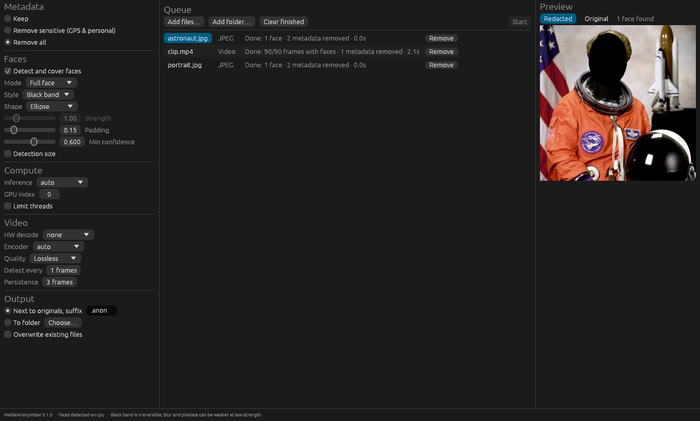

# MediaAnonymizer

**Remove metadata and redact faces in photos and videos — without losing quality.**

MediaAnonymizer is a fast, privacy-first tool, available as a command-line
program (`mediaanon`), a desktop application (`mediaanon-gui`) and a mobile
app for Android and iOS ([docs/MOBILE.md](docs/MOBILE.md)). Everything runs
locally on your device: no upload, no telemetry.

<p align="center"></p>

| Feature | Details |
|---|---|
| **Remove all metadata** | EXIF, XMP, IPTC, comments, maker notes, thumbnails, container tags, chapters, cover art, GPS telemetry tracks. |
| **Remove only sensitive data** | GPS/location, owner and author names, serial numbers, unique IDs, maker notes, XMP, previews — while keeping camera model, exposure settings and dates. |
| **Face redaction** | Modes: `eyes-only` or `full-face`. Styles: `black-band`, `blur`, `pixelate`. Bands follow head tilt; video detections are smoothed over time so a face missed for a few frames stays covered. |
| **Timestamp overlay** | Burn the capture date into the picture, bottom-left or bottom-right, with a configurable format. The date is read from EXIF / video tags *before* metadata removal, so you can strip the metadata and keep the date visible. |
| **Video timeline** | Scrub through a video with a live preview of the selected frame, and add keyframes to change the face settings for part of the video, leave a part unredacted, hide the timestamp, or cut a part out (GUI, or `--timeline` in the CLI). |
| **Faces left visible** | Every face is covered by default; click a face in the preview to leave it visible (e.g. a public official or a consenting speaker). In videos the face is followed from that frame until it is lost. |
| **No quality loss** | Metadata removal never re-encodes. JPEG faces are redacted *in the DCT domain*: only the 8×8 blocks touching a face change, the rest of the file is bit-identical. Videos are re-encoded **mathematically lossless** by default. |
| **Hardware acceleration** | Face detection on CPU, CUDA, TensorRT, DirectML, Core ML, OpenVINO or ROCm, with GPU selection. Video decoding with CUDA/NVDEC, VA-API, Quick Sync, VideoToolbox, D3D11VA, DXVA2 or Vulkan, and encoding with NVENC, QSV, VA-API, VideoToolbox or AMF. |
| **Fast** | Multi-threaded batch processing, a pipelined video engine (decode ∥ detect ∥ paint ∥ encode), native-pixel-format processing (no RGB round trip), recycled frame buffers. |

Supported inputs: **JPEG, PNG, WebP, TIFF, BMP** photos and anything
[FFmpeg](https://ffmpeg.org) can read for videos (MP4, MOV, MKV, WebM, AVI,
MTS, …).

---

## Quick start

```sh
# Remove every piece of metadata (writes photo.anon.jpg next to photo.jpg)
mediaanon process --strip-metadata photo.jpg

# Remove GPS and personal data only, keep camera settings
mediaanon process --strip-sensitive IMG_1234.jpg

# Blur every face in a folder tree and mirror it into another folder
mediaanon process --faces --face-style blur -r ~/Pictures/Party -o ~/Pictures/Party-anon

# Black band over the eyes in a video, decoding and encoding on an NVIDIA GPU
mediaanon process --strip-metadata --face-mode eyes-only --hwaccel cuda --device cuda clip.mp4

# Strip everything but print the capture date in the bottom-left corner
mediaanon process --strip-metadata --timestamp-position bottom-left photo.jpg

# What is hidden in this file?
mediaanon inspect photo.jpg

# Which accelerators can I use?
mediaanon devices
```

`mediaanon inspect` output:

```text
photo.jpg
    APP0 JFIF                    14 B (kept: needed for rendering)
    APP1 EXIF                    Make: TestCam
    APP1 EXIF                    Model: Model X
  ! APP1 EXIF                    Artist: Jane Doe
  ! APP1 EXIF                    GPS position 45.500000, -73.251000
  ! COM comment                  shot by Jane
```

Every option is described in [docs/CLI.md](docs/CLI.md); the desktop app in
[docs/GUI.md](docs/GUI.md).

## Installation

### Download

Ready-to-use builds are attached to every
[GitHub release](../../releases):

* **macOS** (13.4+, Apple silicon): open the `.dmg` and drag
  *MediaAnonymizer* to Applications. Unless the release is notarized, macOS
  blocks the first launch; see [the app does not open](#macos-the-app-does-not-open).
* **Windows**: run the `…-setup.exe` installer, or unzip the portable `.zip`.
  SmartScreen may ask to confirm (**More info → Run anyway**).
* **Linux**: extract the `.tar.gz` and run `mediaanon-gui` or `mediaanon`.

Install [FFmpeg](https://ffmpeg.org/download.html) to process videos
(`brew install ffmpeg`, `winget install ffmpeg`, `sudo apt install ffmpeg`).
Maintainers: see [docs/RELEASING.md](docs/RELEASING.md).

### Requirements

* **FFmpeg 5.1 or newer** (`ffmpeg` and `ffprobe`) on your `PATH` — only
  needed for videos. Set `MEDIAANON_FFMPEG` / `MEDIAANON_FFPROBE` to use
  specific binaries.
* To build from source: **Rust 1.92+** (1.95+ for the GUI) and a C compiler (for the bundled
  libjpeg).

### From source

```sh
git clone <repository-url> MediaAnonymizer
cd MediaAnonymizer
cargo build --release                    # CLI   -> target/release/mediaanon
cargo build --release -p mediaanon-gui   # GUI   -> target/release/mediaanon-gui
```

The default build downloads a CPU build of ONNX Runtime and places it next to
the binaries. GPU builds and bring-your-own ONNX Runtime are covered in
[docs/HARDWARE_ACCELERATION.md](docs/HARDWARE_ACCELERATION.md), e.g.:

```sh
cargo build --release --features cuda          # NVIDIA (Linux / Windows)
cargo build --release --features directml      # any DirectX 12 GPU (Windows)
cargo build --release --features coreml        # Apple silicon / macOS
```

### Running the GUI

```sh
cargo run --release -p mediaanon-gui                      # or: target/release/mediaanon-gui
cargo run --release -p mediaanon-gui -- ~/Pictures/trip   # pre-fill the queue
```

`-p mediaanon-gui` is required: a plain `cargo build` / `cargo run` only builds
the library and the CLI. Add `--features coreml`, `cuda` or `directml` for GPU
face detection, then choose the device under **Compute → Inference**. See
[docs/GUI.md](docs/GUI.md) for a tour of the interface.

Platform prerequisites:

* **macOS** 13.4 or newer: Xcode Command Line Tools (`xcode-select --install`) and, for
  videos, `brew install ffmpeg`.
* **Windows**: Visual Studio Build Tools (C++ workload) and FFmpeg on `PATH`
  for videos.
* **Linux**: a C compiler (`build-essential`), an OpenGL driver (Mesa) and
  `libxkbcommon-x11-0` (X11) or `libwayland-client0` (Wayland).

### Troubleshooting

**`feature 'edition2024' is required`** (or another "failed to parse
manifest" error from a dependency): your Rust toolchain is too old. The CLI
needs Rust 1.92+, the GUI 1.95+. Check with `rustc --version`, then:

```sh
rustup update stable          # Rust installed with rustup (recommended)
brew upgrade rust             # Rust installed with Homebrew (`which cargo` shows /opt/homebrew/...)
```

To move from Homebrew's Rust to rustup, which makes updates easier:

```sh
brew uninstall rust
curl --proto '=https' --tlsv1.2 -sSf https://sh.rustup.rs | sh
source "$HOME/.cargo/env"
```

**macOS: `Undefined symbols ... ___isPlatformVersionAtLeast`** (preceded by
many `was built for newer 'macOS' version (13.4) than being linked (11.0)`
warnings): the prebuilt ONNX Runtime requires macOS 13.4+ and clang's runtime
library. The repository handles both: `.cargo/config.toml` sets
`MACOSX_DEPLOYMENT_TARGET=13.4` and `crates/core/build.rs` links
`libclang_rt.osx.a`, found through `cc --print-resource-dir` (it comes with
the Xcode Command Line Tools). If you still see the error (an older checkout,
or the variable is overridden in your shell), run:

```sh
export MACOSX_DEPLOYMENT_TARGET=13.4
cargo clean
cargo run --release -p mediaanon-gui
```

Binaries built this way require macOS 13.4 (Ventura) or newer.

**ONNX Runtime download fails during the build** (offline machine, proxy):
build with `--no-default-features --features ort-dynamic` and point
`ORT_DYLIB_PATH` at an existing ONNX Runtime library, see
[docs/HARDWARE_ACCELERATION.md](docs/HARDWARE_ACCELERATION.md#bring-your-own-onnx-runtime).

#### macOS: the app does not open

Releases that are not notarized are blocked by Gatekeeper the first time:
nothing happens, or macOS says that *MediaAnonymizer is damaged and can't be
opened* or that *Apple could not verify* it. Since macOS 15 (Sequoia, and
Tahoe) right-click → **Open** no longer bypasses this. Either:

* open **System Settings → Privacy & Security**, scroll down and click
  **Open Anyway** next to MediaAnonymizer (after a first attempt to open it), or
* remove the quarantine flag from a terminal, then open the app normally:

  ```sh
  xattr -dr com.apple.quarantine /Applications/MediaAnonymizer.app
  ```

If it still does not start, run it from a terminal to see the error, and
include the output in a bug report:

```sh
MEDIAANON_LOG=debug /Applications/MediaAnonymizer.app/Contents/MacOS/mediaanon-gui
```

**More logs**: run with `MEDIAANON_LOG=debug`.

## How quality is preserved

| Operation | Photo | Video |
|---|---|---|
| Metadata removal | Container-level edit: JPEG segments, PNG chunks, WebP RIFF chunks, EXIF directories edited in place. Compressed image data is copied byte-for-byte. | `ffmpeg -c copy` remux: every audio/video packet is copied unchanged. |
| Face redaction | **JPEG**: DCT-domain edit — only the blocks overlapping a face are recomputed, all other blocks are bit-identical. **PNG / TIFF / BMP**: lossless re-encode at the same bit depth. **WebP**: lossless WebP. | Decoded and processed in the **source pixel format** (8/10/12/16-bit YUV, RGB, gray — no color conversion), re-encoded with the source codec in **lossless** mode by default (`--quality visually-lossless` / `high` for smaller files). Audio and subtitles are stream-copied. |

Faces are detected on the image as it is displayed (EXIF orientation and video
rotation are honoured), so sideways phone pictures work out of the box.

Details: [docs/ARCHITECTURE.md](docs/ARCHITECTURE.md).

## Privacy notes

* **Black band** is irreversible. **Blur** and **pixelate** are strong by
  default (relative to the face size) but are, in principle, more vulnerable
  to reconstruction; prefer black band for high-risk material, and avoid
  lowering `--strength`.
* **Eyes-only** keeps most of the face visible and does not prevent
  recognition by people who know the subject. Use `full-face` when identity
  must be protected.
* No detector is perfect: profiles, tiny or heavily occluded faces can be
  missed. Lower `--min-confidence` and raise `--detection-size` for crowded or
  high-resolution scenes, and review the results.
* When faces are redacted, embedded **thumbnails and secondary images**
  (EXIF thumbnail, MPF/depth/gain maps, XMP, maker notes, cover art) are
  always removed because they still show the original faces.

The exact list of what each mode removes is in [docs/PRIVACY.md](docs/PRIVACY.md).

## Project layout

```text
crates/core   mediaanon-core: the engine (metadata, detection, redaction, photo & video pipelines)
crates/cli    mediaanon: command-line interface
crates/gui    mediaanon-gui: desktop application (egui)
crates/mobile mediaanon-mobile: C ABI used by the mobile app
mobile/       Flutter app for Android and iOS (photos)
models/       bundled YuNet face detector (MIT)
docs/         user and developer documentation
```

The core crate can be used as a library — see the crate docs
(`cargo doc -p mediaanon-core --open`).

## Contributing

Contributions are welcome! Please read [CONTRIBUTING.md](CONTRIBUTING.md) and
our [Code of Conduct](CODE_OF_CONDUCT.md). Security or privacy issues: see
[SECURITY.md](SECURITY.md).

## License

Licensed under either of [Apache License 2.0](LICENSE-APACHE) or
[MIT license](LICENSE-MIT) at your option.

Third-party components:

* [YuNet](https://github.com/ShiqiYu/libfacedetection) face detection model — MIT
  ([models/LICENSE-YuNet](models/LICENSE-YuNet)).
* [ONNX Runtime](https://onnxruntime.ai) — MIT.
* [Hack](https://sourcefoundry.org/hack/) font, used for the timestamp — MIT / Bitstream Vera
  ([crates/core/assets/LICENSE-Hack.txt](crates/core/assets/LICENSE-Hack.txt)).
* [mozjpeg](https://github.com/mozilla/mozjpeg) / libjpeg-turbo (statically linked) — IJG, BSD-3-Clause, zlib.
* [FFmpeg](https://ffmpeg.org) is invoked as an external program and is not
  distributed with MediaAnonymizer; its license depends on your build.
